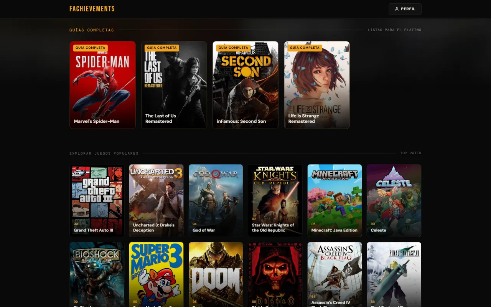
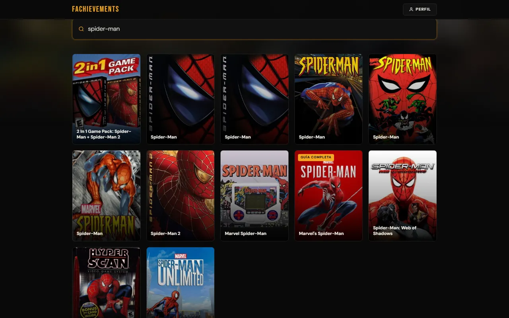
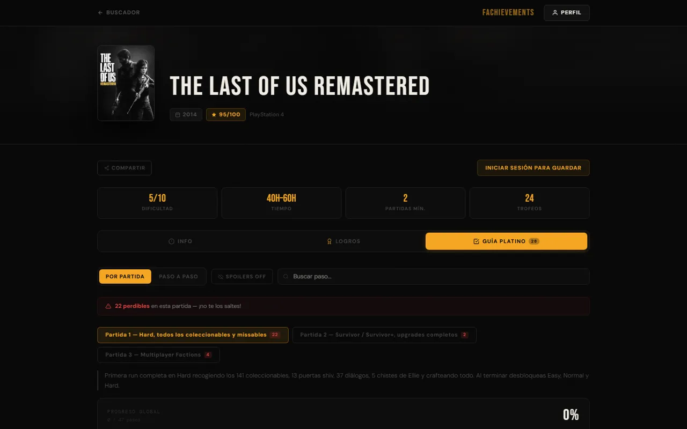

<div align="center">

# Fachievements

**Step-by-step trophy and achievement guides to earn the platinum in your favorite games.**

[Live demo](https://fachievements.pages.dev) · [Report a bug](https://github.com/CarlosFloresDev/Fachievements/issues)


</div>



## Overview

Fachievements lets players search any game, open a complete platinum guide and track their progress step by step, without leaving the page.

- **Global game catalog** — search powered by IGDB (Twitch API), with covers, screenshots, ratings and synopsis.
- **Complete guides** — difficulty, estimated time, minimum playthroughs, full trophy list and a route split into playthroughs → zones → steps (missable, collectible, tip, main and YouTube video steps).
- **Progress tracking** — sign in and check off steps; progress is stored per user in Supabase with Row Level Security.
- **Steam-style profiles** — streaks, badges, avatar frames, game showcase and a public profile at `/u/<handle>`.
- **Any Steam game** — games without a written guide still show their full Steam achievement list (localized, with global unlock rates and hidden achievements protected) and can be tracked.
- **Admin panel** — upload guides as JSON manifests, validated before saving.

| Search | Guide |
|---|---|
|  |  |

## Tech stack

| Layer | Technology |
|---|---|
| Framework | Astro 7 (SSR) + React 19 islands |
| Styling | Tailwind CSS 4 |
| Data & auth | Supabase (Postgres, Auth, RLS) |
| Game metadata | IGDB API via Twitch OAuth |
| Achievements | Steam Web API |
| Hosting | Cloudflare Workers (`@astrojs/cloudflare`) |
| CI | GitHub Actions (build) |

## Architecture

```
src/
├─ components/   React islands: SearchBar, GameView, Tracker, Profile, Auth
├─ layouts/      Base layout with SEO and footer
├─ lib/          igdb.ts, supabase.ts, badges.ts, streak.ts, types.ts
└─ pages/
   ├─ index.astro         Home: search, available guides, popular games
   ├─ guias/[id].astro    Game page and guide (by IGDB id)
   ├─ perfil.astro        Private profile
   ├─ u/[handle].astro    Public profile
   ├─ admin.astro         Guide upload panel
   └─ api/                search, guides, featured, game-covers, profile, admin/*
supabase/migrations/      SQL schema, RLS policies and triggers
docs/                     Guide manifest schema and AI prompt
```

## Getting started

```bash
pnpm install
cp .env.example .env      # fill in Supabase, Twitch and admin values
pnpm dev                  # http://localhost:4321
```

Apply the database schema by running the files in `supabase/migrations/` in order (Supabase → SQL Editor).

### Environment variables

| Variable | Scope | Purpose |
|---|---|---|
| `PUBLIC_SUPABASE_URL` | client | Supabase project URL |
| `PUBLIC_SUPABASE_ANON_KEY` | client | Public anon key |
| `SUPABASE_SERVICE_ROLE_KEY` | server | Writes from the admin panel |
| `TWITCH_CLIENT_ID` / `TWITCH_CLIENT_SECRET` | server | IGDB access |
| `STEAM_API_KEY` | server | Full Steam achievement lists |
| `ADMIN_PASSWORD` | server | Protects `/admin` |

## Scripts

| Command | Description |
|---|---|
| `pnpm dev` | Development server |
| `pnpm build` | Production build |
| `pnpm check` | Type check (Astro + TypeScript) |
| `pnpm validate <file>` | Validate a guide manifest |
| `pnpm deploy` | Build and deploy to Cloudflare |

## Adding a guide

1. Generate a manifest following [`docs/SCHEMA.md`](docs/SCHEMA.md) (an AI prompt is available in [`docs/PROMPT_GUIA.md`](docs/PROMPT_GUIA.md)).
2. Validate it with `pnpm validate guide.json`.
3. Upload it from `/admin`. It becomes available at `/guias/<igdb_id>`.

## License

MIT © Carlos Llano
